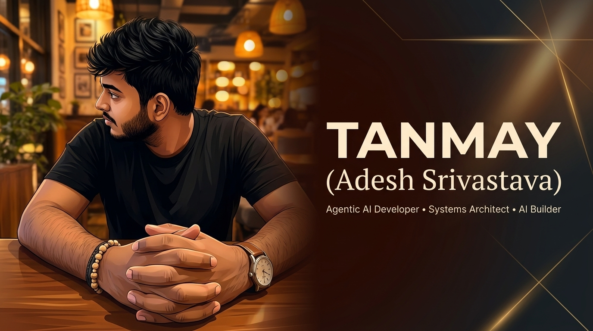

<!-- ═══════════════════════════════════════════════════════════════════════════ -->
<!-- HERO BANNER (NEON LIGHTNING BLUE & OBSIDIAN BLACK)                         -->
<!-- ═══════════════════════════════════════════════════════════════════════════ -->

  

<!-- DYNAMIC TYPING SVG BANNER (CYBERNETIC NEON BLUE) -->

  

<!-- QUICK IDENTITY BADGES -->

  
  &nbsp;
  
  &nbsp;
  
  &nbsp;
  

---
## ⚡ ABOUT ME

<table>
<tr>
<td width="52%" valign="top">

### 🧠 The Core Architecture

Hey there! I'm **Tanmay (Adesh Srivastava)** — an **Agentic AI Developer**, **Student**, and **AI Builder**.

I focus on the intersection of **low-level systems architecture** and **autonomous AI intelligence**. While many treat AI as just simple prompts, I architect **multi-agent orchestration frameworks**, deterministic tool-use pipelines, and high-performance open-source curricula.

- 🤖 **Specialization:** Autonomous Agents, LLM Tool Integration & Zero-Dependency Systems
- 🎓 **Identity:** Student pushing the frontier of practical AI engineering
- ⚡ **Engineering Mindset:** Code that is fast, resilient, and built from first principles

</td>
<td width="48%" valign="top">

### 🚀 Real-Time Focus

| Status | Activity |
| :---: | :--- |
| 🤖 | **Architecting** autonomous multi-agent loops & task runners |
| 🎓 | **Undergraduate Student** exploring systems & AI algorithms |
| ⚡ | **Maintaining** production-grade C, Python, CSS & Web repositories |
| 🛠️ | **Building** zero-dependency high-throughput web dashboards |
| 🌐 | **Deploying** open-source code with real-world impact |

### 💡 Key Project Builds

- 🏎️ [**BMW i7 & FoodDrop**](https://github.com/tanmay119-pera/WEB-DEVELOPMENT-PROJECTS) — Production web apps with fluid UX & delivery engine
- 🛡️ [**C Systems Suite**](https://github.com/tanmay119-pera/C-PROGRAMMING-FUNDAMENTALS) — 12 chapters & 10 builds: memory safety, pointers & sockets
- 🐍 [**Python Automation**](https://github.com/tanmay119-pera/PYTHON-PROGRAMMING-FUNDAMENTALS) — 10 production pipelines, algorithms & automation
- ⚡ [**Friday Framework**](https://github.com/tanmay119-pera/CSS-PROGRAMMING-FUNDAMENTALS) — Zero-dependency modular UI styling system

</td>
</tr>
</table>

  
  &nbsp;
  
  &nbsp;
  

---
## 🛠️ TECH ARSENAL

### 🤖 Autonomous AI & Agentic Stack

  
  &nbsp;
  
  &nbsp;
  
  &nbsp;
  

  
  &nbsp;
  
  &nbsp;
  

### 💻 Core Systems & Programming Languages

  

### 🧰 Developer Tools & Environment

  
  

---
## 📚 SECTION 1: CODING LANGUAGE SETS I MADE

  <b>Comprehensive, production-grade learning curricula, architectural masterclasses, and code sets engineered by Tanmay:</b>

<table>
  <thead>
    <tr>
      <th width="22%">Language Curriculum</th>
      <th width="18%">Scope & Scale</th>
      <th width="45%">Core Architectural Concepts Mastered</th>
      <th width="15%">Access</th>
    </tr>
  </thead>
  <tbody>
    <tr>
      <td>
        
         
        <strong><a href="https://github.com/tanmay119-pera/C-PROGRAMMING-FUNDAMENTALS">C Systems Suite</a></strong>
      </td>
      <td>
        <code>12 Chapters</code> 
        <code>10 Projects</code> 
        
      </td>
      <td>
        Close-to-the-metal programming from fundamental syntax to advanced memory safety. Covers explicit stack vs. heap allocation, pointer arithmetic, dynamic memory allocation (<code>malloc</code>/<code>realloc</code>/<code>free</code>), custom struct vectors, file stream sanitization, and leak profiling with Valgrind.
      </td>
      <td>
        
      </td>
    </tr>
    <tr>
      <td>
        
         
        <strong><a href="https://github.com/tanmay119-pera/PYTHON-PROGRAMMING-FUNDAMENTALS">Python A-to-Z</a></strong>
      </td>
      <td>
        <code>10 Chapters</code> 
        <code>50+ WAPs</code> 
        <code>10 Projects</code> 
        
      </td>
      <td>
        From syntax basics to advanced Object-Oriented software engineering. Deep dives into Pythonic data structures (lists, tuples, dicts, sets), recursion stacks, context managers, file streams, class encapsulation, inheritance hierarchies, and dunder methods. Includes 10 real-world automation tools.
      </td>
      <td>
        
      </td>
    </tr>
    <tr>
      <td>
        
         
        <strong><a href="https://github.com/tanmay119-pera/CSS-PROGRAMMING-FUNDAMENTALS">Modern CSS Systems</a></strong>
      </td>
      <td>
        <code>5 Chapters</code> 
        <code>7 Practice Sets</code> 
        <code>Capstone Build</code> 
        
      </td>
      <td>
        Engineering modern, responsive web interfaces without bloated frameworks. Comprehensive mastery of the CSS Box Model, Flexbox layouts, 2-dimensional CSS Grid, responsive media queries, CSS variables (custom properties), and glassmorphism styling culminate in the Friday Framework capstone.
      </td>
      <td>
        
      </td>
    </tr>
    <tr>
      <td>
        
         
        <strong><a href="https://github.com/tanmay119-pera/HTML-PROGRAMMING-FUNDAMENTALS">HTML5 Semantics</a></strong>
      </td>
      <td>
        <code>5 Chapters</code> 
        <code>Notes + SEO</code> 
        <code>2 Projects</code> 
        
      </td>
      <td>
        The definitive guide to modern semantic web markup. Covers document tree architecture, accessible semantic containers (<code>&lt;article&gt;</code>, <code>&lt;section&gt;</code>, <code>&lt;dialog&gt;</code>), defensive form controls with client-side validation, web accessibility (a11y), and OpenGraph SEO metadata.
      </td>
      <td>
        
      </td>
    </tr>
    <tr>
      <td>
        
         
        <strong><a href="https://github.com/tanmay119-pera/JAVA.SCRIPT-PROGRAMMING-FUNDAMENTALS">JavaScript Core</a></strong>
      </td>
      <td>
        <code>ES6+ Modules</code> 
        <code>Async Flow</code> 
        
      </td>
      <td>
        Modern JavaScript from fundamentals to event-driven programming. Deep dive into execution contexts, closures, higher-order array methods (<code>map</code>, <code>filter</code>, <code>reduce</code>), DOM element traversal, event bubbling/delegation, and asynchronous pipelines (Promises, async/await, Fetch API).
      </td>
      <td>
        
      </td>
    </tr>
    <tr>
      <td>
        
         
        <strong><a href="https://github.com/tanmay119-pera/C-PLUS-PLUS-PROGRAMMING-FUNDAMENTAL">C++ & OOP</a></strong>
      </td>
      <td>
        <code>OOP Blueprints</code> 
        <code>STL & Systems</code> 
        
      </td>
      <td>
        High-performance Object-Oriented Programming and systems development. Explores memory models, constructors/destructors, operator overloading, inheritance, runtime polymorphism with virtual tables (vtables), and standard template library (STL) containers and algorithms.
      </td>
      <td>
        
      </td>
    </tr>
  </tbody>
</table>

---
## 🚀 SECTION 2: PROJECTS I MADE

  <b>Production applications, 3D WebGL experiences, autonomous AI agents, and systems-level tools engineered by Tanmay:</b>

### 🌐 1. Full-Stack & Modern Web Experiences

<table>
  <tr>
    <td width="50%" valign="top">

#### 🏎️ [The New BMW i7 & 7 Series — 3D Web Experience](https://github.com/tanmay119-pera/WEB-DEVELOPMENT-PROJECTS)
*Interactive 3D WebGL Ultra-Luxury Automotive Showcase*

- **Tech Stack:** `React 18` • `Three.js` • `Tailwind CSS` • `Framer Motion` • `WebGL`
- **Key Features:**
  - Real-time 3D vehicle canvas with 360° orbit camera controls and dynamic lighting.
- **Repository:** [`WEB-DEVELOPMENT-PROJECTS`](https://github.com/tanmay119-pera/WEB-DEVELOPMENT-PROJECTS)

    </td>
  </tr>
</table>

## 🎯 AGENTIC AI & SYSTEMS ROADMAP

-38BDF8?style=for-the-badge&logo=javascript&logoColor=black&labelColor=080C14)

---

## 🤝 CONNECT & COLLABORATE

  
  &nbsp;&nbsp;
  
  &nbsp;&nbsp;
  
  &nbsp;&nbsp;
  

---

  

